# insurance-data-warehouse-snowflake
End-to-end multi-tenant insurance data platform built on Snowflake using Snowpark Python, Streams &amp; Tasks CDC, SCD Type 2 policy modeling, and Row-Level Security.

# Multi-Tenant Insurance Data Platform (Snowflake & Snowpark Python)

An end-to-end, cloud-native ELT data platform built on **Snowflake** using **Snowpark Python**, **Change Data Capture (Streams & Tasks)**, **SCD Type 2 dimensional modeling**, and **Multi-Tenant Row-Level Security (RLS)** for insurance policy and claims analytics.

---

## Architecture Overview

```mermaid
flowchart LR
    A[Source Systems<br/>Python Synthetic Generator] -->|JSON Events| B[Snowflake Internal Stage<br/>INSURANCE_LANDING_STAGE]
    B -->|COPY INTO| C[(RAW Schema<br/>VARIANT Tables)]
    C -->|Append-Only CDC| D[Snowflake Streams]
    D -->|Triggered every 5m<br/>SYSTEM\$STREAM_HAS_DATA| E[Snowflake Task]
    E -->|Executes| F[Snowpark Python Proc<br/>JSON Parsing & SCD Type 2]
    F --> G[(STAGING Schema<br/>SCD2 Policies & Claims)]
    G -->|Row Access Policy<br/>Broker Isolation| H[ANALYTICS Schema<br/>Star Schema & KPI Views]
    H --> I[BI & Reporting<br/>Qlik / Power BI / Tableau]
```

---

## Key Features & Engineering Highlights

1. **Medallion Multi-Layer Architecture (`RAW` → `STAGING` → `ANALYTICS`):**
   - Separates immutable raw `VARIANT` JSON ingestion from cleansed historical staging tables and BI-ready dimensional models.
   - Configured with auto-suspending Virtual Warehouses (`WH_INSURANCE_ANALYTICS_XS`) for cost-efficient compute management.

2. **Incremental CDC & Snowpark Python Transformations:**
   - Uses append-only **Snowflake Streams** to capture newly arrived policy and claim records without full table scans.
   - Implements a native **Snowpark Python Stored Procedure** (`SP_PROCESS_INSURANCE_CDC`) to flatten nested policy coverage structures and process **Slowly Changing Dimensions (SCD Type 2)** for mid-term policy endorsements.

3. **Event-Driven Orchestration:**
   - Automated via **Snowflake Tasks** paired with `SYSTEM$STREAM_HAS_DATA()`, ensuring compute is only consumed when new records arrive in the stream.

4. **Multi-Tenant SaaS Security (Row-Level Security):**
   - Enforces tenant isolation across insurance brokers (`BRK_NL_001`, `BRK_NL_002`, `BRK_NL_003`) using a **Snowflake Row Access Policy** (`RAP_BROKER_ISOLATION`) mapped to RBAC roles (`ROLE_BROKER_001`).

5. **Insurance Domain KPIs:**
   - Exposes `VW_BROKER_PORTFOLIO_KPIS` and Star Schema views (`DIM_BROKER`, `DIM_POLICY_CURRENT`, `FACT_CLAIMS`) tracking **Gross Written Premium (GWP)**, **Total Incurred Claims**, **Reporting Lag**, and **Loss Ratio (%)**.

---

## Repository Structure

| File | Description |
| :--- | :--- |
| `data_generator/02_generate_insurance_data.py` | Generates realistic multi-broker policy, mid-term endorsement, and claims NDJSON batches. |
| `sql/01_insurance_setup.sql` | Provisions the warehouse, database, schemas (`RAW`, `STAGING`, `ANALYTICS`), and JSON stage. |
| `sql/02_ingest_raw_data.sql` | Loads staged NDJSON files into `VARIANT` landing tables with file lineage metadata. |
| `sql/03_streams_and_staging_tables.sql` | Creates append-only CDC Streams and Silver SCD Type 2 target tables. |
| `sql/04_snowpark_transformations.sql` | Deploys the Snowpark Python stored procedure for JSON parsing, SCD2 history tracking, and claims merging. |
| `sql/05_orchestration_tasks.sql` | Configures conditional Task scheduling based on stream availability. |
| `sql/06_analytics_star_schema.sql` | Builds Gold dimensional views and insurance Loss Ratio KPI aggregations. |
| `sql/07_multi_tenant_rls.sql` | Implements Row Access Policies and verifies multi-tenant data isolation across broker roles. |

---

## How to Run

1. **Generate Sample Data:** Run `python data_generator/02_generate_insurance_data.py` locally to produce `policies_batch_01.json` and `claims_batch_01.json`.
2. **Initialize Snowflake:** Execute `sql/01_insurance_setup.sql` in a Snowflake Enterprise trial account.
3. **Stage & Ingest:** Upload the generated JSON files to `INSURANCE_LANDING_STAGE` via Snowsight and run `sql/02_ingest_raw_data.sql`.
4. **Deploy CDC & Snowpark:** Run `sql/03_streams_and_staging_tables.sql` and `sql/04_snowpark_transformations.sql`.
5. **Automate & Secure:** Execute `sql/05_orchestration_tasks.sql`, `sql/06_analytics_star_schema.sql`, and `sql/07_multi_tenant_rls.sql`.
